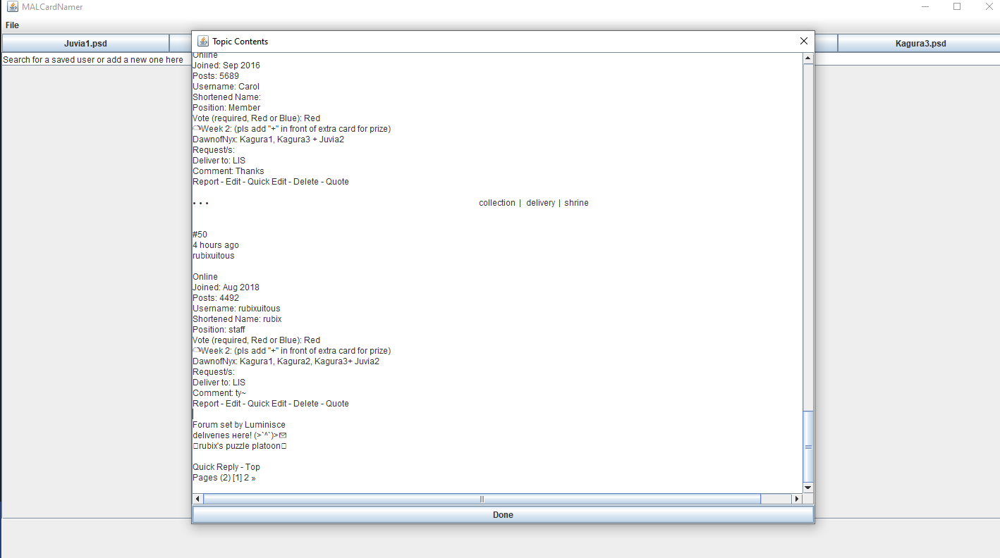
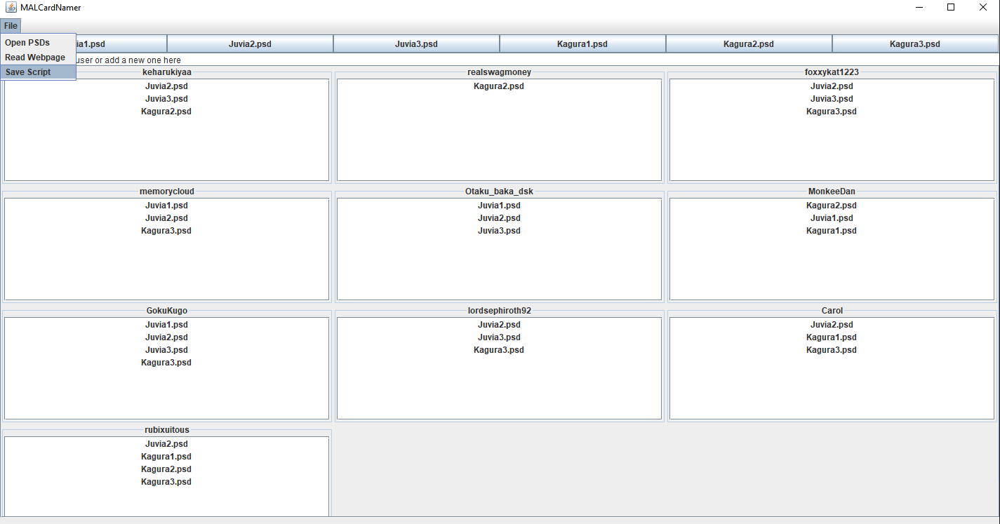

# MALCardNamer

**Automates naming collectible cards in Photoshop for MyAnimeList card-making communities.**

On MyAnimeList, artists ("cardmakers") run editions of collectible cards that members request and receive personalized with their name. Every requested card had to be renamed by hand in Photoshop, one file at a time. That made naming slow, so cardmakers capped how many cards each person could request.

MALCardNamer removes that bottleneck. It reads the request page, works out who asked for which cards, and writes a Photoshop script that names every card automatically. No coding is needed.

Before Parsing
---

After Parsing
---

## Why I built it

I was naming cards for my own first edition and realized the work was pure repetition, so I wrote a Photoshop script by hand to do it. That worked, but writing a new script for every edition was almost as tedious as naming the cards, and other cardmakers couldn't write scripts at all. So I built a program to **write the script for you**: automating the automation.

## How it works

1. **Load your cards.** Open your PSD files in the app. Each one appears as a draggable button.
2. **Add the requests.** Either:
   - **Automatic:** copy the whole request page from MyAnimeList (one or more pages) and paste it in. The app parses each requester's name and the cards they picked.
   - **Manual:** add requesters yourself and drag PSDs into each person's list.
3. **Adjust card settings.** Click any PSD to set:
   - **Replace word:** the placeholder text in the PSD that gets swapped for the requester's name
   - **Character limit:** the longest name that fits on the card
   - **Alternate name:** the label used on the request page if it differs from the file name (e.g. card numbers like `DawnofNyx: 1, 3, 4`)
4. **Generate the script.** Choose an output folder and the app writes a Photoshop script.
5. **Run it in Photoshop.** Go to `File → Scripts → RenameMalCards` and every card is named and saved automatically.

Under the hood, the desktop app is written in **Java (Swing)** and fills in a **Photoshop scripting (JavaScript) template** to generate each script.

## Requirements

- Java 11 or later
- Adobe Photoshop

## Installation

Download the latest release, unzip it, and run the `.jar` file.

Releases and the full user guide are hosted in the [MALCardNamer Program Club](https://myanimelist.net/clubs.php?cid=83478) on MyAnimeList, including a [detailed walkthrough of the automatic method](https://myanimelist.net/forum/?topicid=1953900).

> Your OS may warn that the `.jar` is from an unknown developer. This is expected for unsigned Java apps.

## Known limitations

The automatic parser depends on how people write their requests. It matches a card only when the requester writes the card name exactly as it's set up (`Kagura2`, not `Kagura 2` or `Kagura1&2`).

In practice, cardmakers either ask requesters to use exact names, or use the automatic method for most requests and add the rest manually. Making the parser handle real-world, inconsistent formatting was the main focus of later updates.

## Release history

- **Sep 2021:** first release, with manual and automatic (experimental) modes
- **Oct 2021 (v1.4.0):** name cards for multiple editions at once
- **Dec 2021 (Holiday update):** major changes and bug fixes

Bugs and feature requests came in from cardmakers through the club's to-do thread, and each release addressed them.

## Author

Vandell Vatel, built in my senior year of high school (2021).
